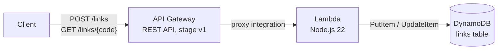

# Serverless URL shortener tested on AWS Emulator

## Project overview

This is a small URL shortener built on API Gateway, Lambda and DynamoDB and
defined with Terraform. You send it a URL, it returns a 7-character code, and
requesting that code redirects you to the URL while counting the visit.

The application itself is simple on purpose. The point of the project is the
pipeline around it: on every push, GitHub Actions deploys the whole stack to
[AWS Emulator](https://github.com/aws/aws-emulator) running on the CI runner,
checks that Terraform is idempotent, sends real HTTP requests through the API,
and destroys everything at the end.

I used AWS Emulator because I wanted to test a serverless architecture end to
end without an AWS account or cloud credentials in CI. Mocks only test the
handler logic, and a real account costs money and needs credentials. The
emulator sits in between: the Terraform code and the AWS SDK calls are the
same, only environment variables point them at a local endpoint. Part of the
work was finding out what that actually validates, and what it does not.

The project has not been deployed to a real AWS account.

## Architecture and technologies



- `POST /links` with `{"url": "https://..."}` goes through API Gateway to the
  Lambda function, which validates the body, generates a code and stores it
  with a conditional `PutItem` (`attribute_not_exists(code)`), so a collision
  never overwrites an existing link. It returns `201`, or `400` if the body is
  not a JSON object with an http(s) URL.
- `GET /links/{code}` runs an `UpdateItem` that increments the hit counter
  atomically and returns the stored URL. The function answers with a `302`
  redirect and `Cache-Control: no-store`, or `404` if the code does not exist.

Terraform ([`infra/`](infra)) defines the 15 resources: the DynamoDB table,
the Lambda function and its log group, an IAM role with one inline policy
(`PutItem` and `UpdateItem` on the table, log streams of the function's log
group, X-Ray traces), and the API Gateway REST API with its routes,
integrations, deployment and stage.

The provider block has no endpoint. `scripts/start-emulator.sh` installs and
starts AWS Emulator, then writes `AWS_ENDPOINT_URL`, the emulator's
credentials and config files, its CA bundle, the region and a few SDK
settings to `.emulator.env` (and to `$GITHUB_ENV` in CI). With those variables
loaded, `terraform apply` talks to the emulator. On the emulator, all APIs
share one endpoint, so the tests reach the API with a
`Host: <api_id>.execute-api.us-east-1.amazonaws.com` header and the stage name
at the start of the path.

**Technologies:** Node.js 22 and the AWS SDK for JavaScript v3, Terraform
1.17.2 (AWS provider 6.73.0), AWS Emulator 1.0.385, GitHub Actions,
`node:test`, pytest with requests and boto3, Checkov, Ruff, Make.

## CI/CD pipeline

The workflow ([`.github/workflows/ci.yml`](.github/workflows/ci.yml)) runs on
pushes to `main`, on pull requests and on manual trigger. It has two jobs.

**Job 1, "Lint, unit tests & security scan"**, needs no infrastructure, so it
fails fast on simple mistakes: JavaScript syntax check, unit tests, Ruff on the
Python tests, `terraform fmt -check`, `terraform validate`, and a Checkov scan
of the Terraform code. Checkov findings were either fixed (X-Ray tracing,
point-in-time recovery, encryption, scoped IAM) or accepted with a written
reason in [`.checkov.yaml`](.checkov.yaml).

**Job 2, "Deploy & test on AWS Emulator"**, only runs if job 1 passed:

1. Starts the emulator and runs `aws sts get-caller-identity` as a smoke test.
2. Runs `terraform plan` (written to the job summary) and `terraform apply`.
3. Runs `terraform plan -detailed-exitcode` again. Exit code 2 means the plan is
   not empty right after an apply, so the job fails if anything drifts.
4. Runs the end-to-end tests against the deployed API.
5. Runs `terraform destroy` and uploads the emulator log, both with
   `if: always()`, so a failed run still cleans up and leaves a log to read.

Terraform, the providers (through
[`infra/.terraform.lock.hcl`](infra/.terraform.lock.hcl)) and the GitHub Actions
(by commit SHA) are pinned, and [`.github/dependabot.yml`](.github/dependabot.yml)
is set up for weekly update PRs (Dependabot only reads it from `main`). The
emulator is the exception: only the latest LTS build has a stable download
URL, so the start script prints the installed version and warns if it is not
the one I tested (1.0.385).

## Testing and results

| Check | Count / result | Where it runs |
| --- | --- | --- |
| Unit tests ([`app/test`](app/test)) | 12 tests, handler with a fake DynamoDB client | CI job 1 and locally |
| End-to-end tests ([`tests/integration`](tests/integration)) | 6 tests through API Gateway, Lambda and DynamoDB | CI job 2 and locally |
| `terraform fmt` / `validate` | Formatted, valid | CI job 1 and locally |
| Checkov | 0 failed checks | CI job 1 and locally |
| `node --check` and Ruff | No errors | CI job 1 and locally |
| Idempotency | No changes after apply | CI job 2 and locally |

The unit tests cover input validation, status codes, base64-encoded bodies,
the retry on a code collision and error handling. The end-to-end tests create
links, follow them, check the `302`, the `Cache-Control` header and the hit
counter, read an item back from DynamoDB with boto3, and check the `400` and
`404` cases.

**In CI**, every run is listed in the
[Actions tab](https://github.com/ilyasZAOUIA/aws-emulator-serverless-ci/actions/workflows/ci.yml).
GitHub only shows the logs and the job summary (with the Terraform plan) to
signed-in users.

**Locally**, I ran the same checks with the Makefile on Ubuntu 22.04 with
Terraform 1.17.2 and AWS Emulator 1.0.385. I also ran manual experiments on the
emulator (removing IAM permissions, configuring throttling) that are not part
of the pipeline; they are written up with their commands in
[`docs/emulator-findings.md`](docs/emulator-findings.md).

## Local setup and execution

Prerequisites, on Ubuntu or Debian:

- Node.js 22 with npm
- Terraform: `infra/versions.tf` allows 1.6 or later; I tested with 1.17.2,
  the version CI uses
- Python 3 with the `venv` module
- `curl`, and `sudo` for the first emulator install
- The AWS CLI, only for manual checks

Typical run:

```bash
make emulator   # install AWS Emulator if needed, start it, write .emulator.env
make lint       # node --check and Ruff
make unit       # unit tests
make deploy     # terraform init and apply against the emulator
make e2e        # end-to-end tests
make destroy    # terraform destroy
make clean      # stop the emulator, remove local Terraform state and build files
```

`make test` runs the unit and end-to-end tests together. `make lint` and
`make e2e` create a `.venv` for the Python tools on first use. If the emulator
is already running, `make emulator` reuses it instead of starting a second one.

The emulator is installed from its `.deb` package with `sudo apt-get`. Without
sudo, the package can be extracted with `dpkg-deb -x` and the `aws-emulator`
binary put on the `PATH`; the script then skips the install.

To check idempotency by hand after `make deploy`:

```bash
set -a; . ./.emulator.env; set +a
terraform -chdir=infra plan -detailed-exitcode   # exit code 0: no changes
```

A [dev container](.devcontainer/devcontainer.json) is included, but I have not
been able to test it: the local builds failed because of network problems on
my machine, so I do not know yet whether it works.

## Challenges and limitations

Issues I ran into:

- **Drift right after apply.** The idempotency check failed on the first run:
  the emulator reports `on_demand_throughput = -1` for an on-demand DynamoDB
  table and the provider plans to remove it every time. I ignored only that
  block (`lifecycle.ignore_changes`) so the check stays strict for everything
  else.
- **A 500 on valid JSON.** A body of `null` is valid JSON, and the handler
  crashed reading `url` from it. It now returns `400` for any body that is not
  a JSON object.
- **301 vs 302.** The redirect started as a `301`, but browsers cache a `301`
  permanently and stop calling the API, so visits stop being counted. It is a
  `302` now.
- **IAM assumptions.** The first policy allowed `GetItem`, which the code never
  uses, gave log permissions on `*`, and had no X-Ray permissions although
  tracing was enabled. I also assumed the emulator ignores IAM. Testing showed
  the opposite: the function runs with its execution role, and removing
  `PutItem` or `UpdateItem` from the policy makes the end-to-end tests fail.
- **Variables that were not needed.** Terraform passes the emulator endpoint,
  credentials and CA to the function. With emulator 1.0.385, the end-to-end
  tests also pass without them; the block is still in the code.
- **Two emulators on one port.** Running `make emulator` twice started a second
  instance that overwrote the first one's log. The script now reuses a running
  emulator.

What the emulator does not validate:

- **Logs and X-Ray permissions.** The emulator does not deliver the function's
  logs to CloudWatch Logs, and records X-Ray traces without checking the role,
  so those parts of the IAM policy are untested.
- **Throttling.** The emulator stores API Gateway throttling settings but does
  not apply them (30 parallel requests with a limit of 1 per second all reached
  the function). I left throttling out of Terraform until it can be tested, but
  the API is public and should have it before any real deployment.
- **AWS itself.** A green run shows that the code works against the emulator,
  not that it works on AWS. IAM evaluation, service limits and behaviour
  differences can only be confirmed with a real deployment.

Other limits: Terraform state is local, which is fine for an environment that
lives for one CI run, and some Checkov findings (no WAF, no customer-managed
KMS keys, no access logs) are accepted for a demo, not for production.

More detail on these choices is in [`docs/decisions.md`](docs/decisions.md).

## Possible improvements

- Deploy to a real AWS account from CI with GitHub OIDC, and check IAM, logs
  and traces there.
- Add stage throttling and test it on AWS with a burst of requests.
- Remove the emulator-only environment variables passed to the function.
- Use a remote Terraform backend (S3 with locking) for a long-lived environment.
