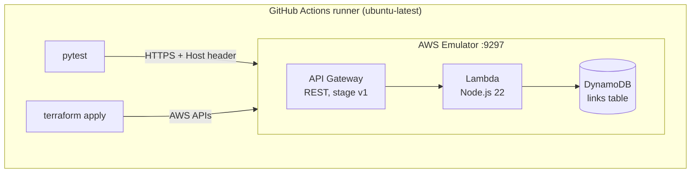
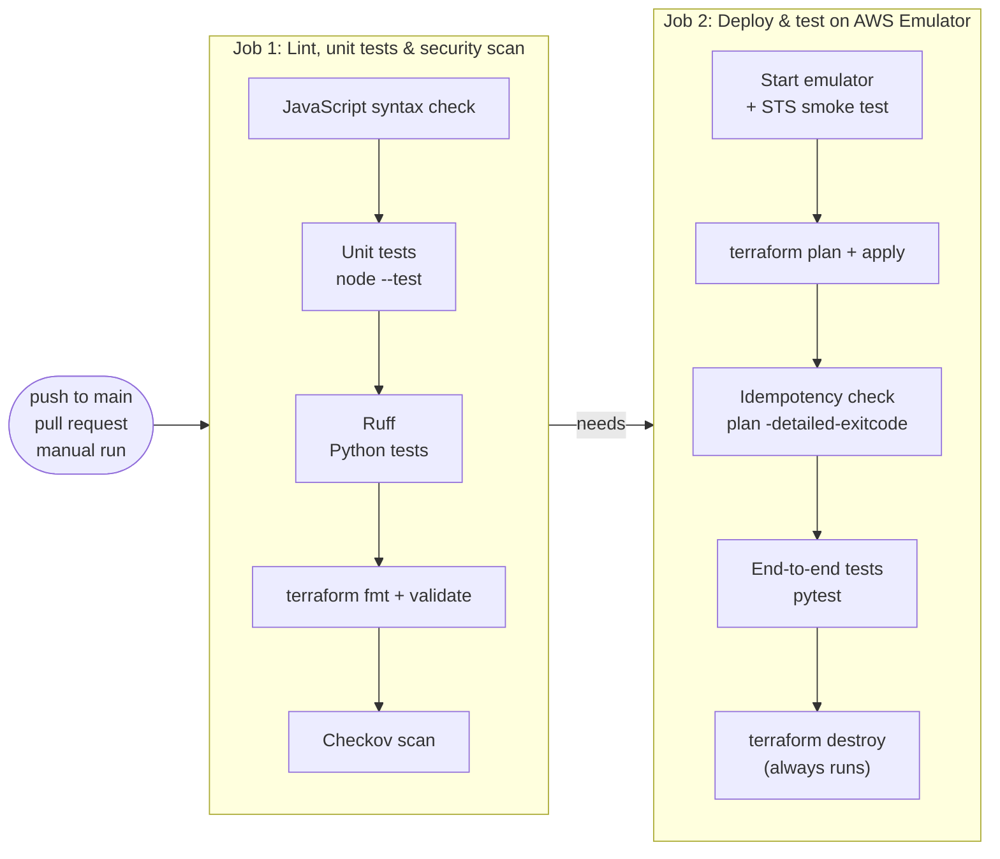

# Serverless URL shortener, tested end-to-end on AWS Emulator

[](https://github.com/ilyasZAOUIA/aws-emulator-serverless-ci/actions/workflows/ci.yml)

A URL shortener built on API Gateway, Lambda (Node.js 22) and DynamoDB, defined
with Terraform. On every push, GitHub Actions starts
[AWS Emulator](https://github.com/aws/aws-emulator) on the runner, deploys the
stack to it, checks that a second `terraform plan` is empty, sends real HTTP
requests through the API, then destroys everything.

The pipeline needs no AWS account and no cloud credentials. The project has
**not** been deployed to a real AWS account (see [Limitations](#limitations)).

## Why

Infrastructure code is usually tested in one of two ways: with mocks, which are
fast but say little about the deployed stack, or in a real AWS account, which
is realistic but costs money and requires giving credentials to CI. This
project uses a local emulator in between: the Terraform code and the AWS SDK
calls are the same, and only environment variables point them at the emulator.
The goal is to see how much of a serverless stack that approach can actually
check, and where it stops.

## Architecture



| Endpoint | Behaviour |
| --- | --- |
| `POST /links` `{"url": "https://..."}` | `201` with a 7-character code; `400` if the body is not a JSON object with an http(s) URL |
| `GET /links/{code}` | `302` redirect with `Cache-Control: no-store`, increments a hit counter; `404` for an unknown code |

Main components ([`infra/main.tf`](infra/main.tf), 15 resources):

- **DynamoDB:** an on-demand `links` table with encryption and point-in-time
  recovery. Codes are created with a conditional write, so a collision cannot
  overwrite an existing link. Hits are counted with an atomic `ADD`.
- **Lambda:** the handler in [`app/src/index.mjs`](app/src/index.mjs), with
  X-Ray active tracing and a log group created by Terraform.
- **IAM:** an execution role with one inline policy limited to what the function
  does: `PutItem` and `UpdateItem` on the table, writing to its own log streams,
  and sending X-Ray traces.
- **API Gateway:** a REST API with two routes, a Lambda proxy integration,
  a deployment and a `v1` stage with X-Ray tracing.

## Pipeline

One workflow, [`ci.yml`](.github/workflows/ci.yml), with two jobs. It runs on
pushes to `main`, on pull requests and on manual trigger.



Job 1 needs no infrastructure and fails fast. Job 2 only starts if job 1
passed. `terraform destroy` and the upload of the emulator log run even when
a previous step failed, so every run cleans up after itself.

Results of every run are public in the
[Actions tab](https://github.com/ilyasZAOUIA/aws-emulator-serverless-ci/actions/workflows/ci.yml).

## Testing strategy

| Layer | What it checks | Where |
| --- | --- | --- |
| Unit tests (12) | Handler logic with a fake DynamoDB client: validation, status codes, base64 bodies, collision retry, error handling | [`app/test`](app/test) |
| Lint | JavaScript syntax (`node --check`), Ruff on the Python tests | Job 1 |
| Static IaC checks | `terraform fmt`, `terraform validate`, Checkov security scan | Job 1 |
| Idempotency | A plan run right after apply must be empty | Job 2 |
| End-to-end tests (6) | HTTP requests through API Gateway, Lambda and DynamoDB, including one that reads the item back from DynamoDB | [`tests/integration`](tests/integration) |

Checkov findings were either fixed (X-Ray, point-in-time recovery, encryption,
scoped IAM) or accepted with a written reason in [`.checkov.yaml`](.checkov.yaml).

### What the emulator validates, and what it does not

Tested with AWS Emulator 1.0.385; details and commands in
[`docs/emulator-findings.md`](docs/emulator-findings.md).

| Validated by the pipeline | Not validated |
| --- | --- |
| Terraform creates and destroys all 15 resources | Deployment to a real AWS account |
| A second plan after apply is empty | How AWS evaluates the IAM policy |
| API Gateway routes requests to the function | Logs permissions (the emulator does not deliver Lambda logs to CloudWatch Logs) |
| The function writes to and updates DynamoDB **with its execution role**: removing `PutItem` or `UpdateItem` from the policy makes the end-to-end tests fail | X-Ray permissions (traces are recorded without checking them) |
| Status codes and headers returned to the client | API throttling (stored by the emulator, not enforced) |

## Running it locally

Tested on Ubuntu 22.04. Requirements: Node.js 22, Terraform (CI uses 1.17.2),
Python 3 with the `venv` module, and `curl`. The AWS CLI is only needed for
manual checks.

```bash
make emulator   # install AWS Emulator if needed (uses sudo apt-get), start it, write .emulator.env
make lint       # node --check + Ruff (Python tools go to .venv)
make unit       # unit tests
make deploy     # terraform init + apply against the emulator
make e2e        # end-to-end tests
make destroy
make clean      # stop the emulator, remove local state and build files
```

`make test` runs the unit and end-to-end tests. `make emulator` reuses an
emulator that is already running on the port instead of starting a second one.

The emulator is installed from the **LTS** channel. Only the latest LTS build
has a stable download URL, so the script cannot pin a version; it prints the
installed version and warns if it differs from the tested one (1.0.385).
Without sudo, the `.deb` can be extracted with `dpkg-deb -x` and the binary
put on the `PATH`.

To check idempotency by hand after `make deploy`:

```bash
set -a; . ./.emulator.env; set +a
terraform -chdir=infra plan -detailed-exitcode   # exit code 0 means no changes
```

A [dev container](.devcontainer/devcontainer.json) for GitHub Codespaces is
included, but it **has not been tested**: building it locally failed several
times because of network issues on the test machine, so it is unknown whether
it works.

## How emulator mode works

The Terraform provider has no hard-coded endpoint. `scripts/start-emulator.sh`
writes these variables to `.emulator.env` (and to `$GITHUB_ENV` in CI):

```bash
AWS_ENDPOINT_URL=https://127.0.0.1:9297
AWS_SHARED_CREDENTIALS_FILE=$HOME/.aws/emulator/9297/emulator_credentials
AWS_CONFIG_FILE=$HOME/.aws/emulator/9297/config
AWS_CA_BUNDLE=$HOME/.aws/emulator/9297/ca.pem    # the emulator uses a self-signed CA
NODE_EXTRA_CA_CERTS=$HOME/.aws/emulator/9297/ca.pem
AWS_EC2_METADATA_DISABLED=true
AWS_DISABLE_HOST_PREFIX_INJECTION=true
AWS_REGION=us-east-1
AWS_DEFAULT_REGION=us-east-1
TF_VAR_emulator_dir=$HOME/.aws/emulator/9297
```

Two emulator-specific details:

1. **API Gateway routing uses the `Host` header.** All APIs share one endpoint;
   the tests send `Host: <api_id>.execute-api.us-east-1.amazonaws.com` and put
   the stage name first in the path.
2. **Emulator variables for the function.** When `emulator_dir` is set,
   Terraform also passes the endpoint, credentials and CA to the function.
   With AWS Emulator 1.0.385 this turned out to be unnecessary: the function
   runs with its execution role and reaches DynamoDB without these variables
   (the end-to-end tests pass either way). The block is still in the code.

## Engineering decisions

Explained in [`docs/decisions.md`](docs/decisions.md), in short:

- **302 instead of 301:** browsers cache a 301 permanently and stop calling the
  API, so visits would not be counted.
- **Least-privilege IAM:** only the two DynamoDB actions the handler uses, logs
  scoped to the function's log group, and the X-Ray permissions that active
  tracing requires.
- **No throttling in Terraform yet:** the emulator ignores throttling settings,
  so they could not be tested.
- **Pinned versions:** Terraform 1.17.2, a committed provider lock file,
  actions pinned by commit SHA, Dependabot for updates.

## Limitations

- **Not deployed to a real AWS account.** The code is written to work there,
  but that is untested.
- **IAM is only partly validated.** The DynamoDB permissions are enforced by the
  emulator and covered by the end-to-end tests. The logs and X-Ray permissions
  are not checked, and AWS's own policy evaluation is untested.
- **No API throttling.** The API is public and unauthenticated; only the
  account-level default limit would apply on AWS.
- **The dev container has not been tested.**
- **Local Terraform state**, which suits an environment that lives for one CI
  run. A shared environment would need a remote backend.
- **Accepted Checkov findings** (no WAF, no customer-managed KMS keys, no access
  logs, among others) are listed with their reasons in
  [`.checkov.yaml`](.checkov.yaml); several would need revisiting before any
  real use.

## Next steps

- Deploy job to a real AWS account using GitHub OIDC, then check IAM, logs and
  traces there
- Stage throttling, tested with a burst of requests on AWS
- Remove the emulator-only environment variables for the function, now that
  they are not needed
- Remote state in S3, WAF and access logging for a long-lived environment

## Project layout

```
app/                       Lambda handler (Node.js 22, AWS SDK v3) + unit tests
infra/                     Terraform: DynamoDB, IAM, Lambda, API Gateway
tests/integration/         pytest end-to-end tests, read Terraform outputs
scripts/start-emulator.sh  Install, start and health-check AWS Emulator
.github/workflows/ci.yml   The pipeline
.github/dependabot.yml     Weekly dependency updates
docs/                      Engineering decisions and emulator findings
.devcontainer/             Dev container for GitHub Codespaces (untested)
```
