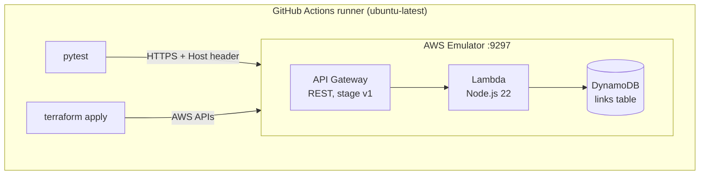
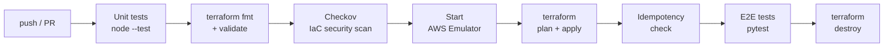

# Serverless CI on AWS Emulator — zero AWS account, zero cost

[](https://github.com/ilyasZAOUIA/aws-emulator-serverless-ci/actions/workflows/ci.yml)


A serverless URL shortener (**API Gateway → Lambda → DynamoDB**) defined with
**Terraform** and tested end-to-end on every push by **GitHub Actions** against
[AWS Emulator](https://github.com/aws/aws-emulator), the official local AWS
emulator released by AWS on 11 November 2026.

Every pipeline run creates a **real, ephemeral environment**: it provisions the
whole stack, checks it is idempotent, sends real HTTP requests through it,
then destroys it. No AWS account, no credentials in GitHub secrets, no bill.

## Why

Testing infrastructure code usually means either mocks (fast, but they prove
little) or a real AWS account (realistic, but slow, costly and risky to give
to CI). AWS Emulator sits in between: the **same Terraform code and the same
SDK calls** run against a local AWS API endpoint. Only environment variables
change, so the code that passes CI is the code you would deploy.

## Architecture



| Endpoint | Behaviour |
| --- | --- |
| `POST /links` `{"url": "https://..."}` | `201` with a 7-char code |
| `GET /links/{code}` | `301` redirect to the URL, increments a hit counter |

## Pipeline



| Stage | What it proves |
| --- | --- |
| **Unit tests** | Handler logic, with DynamoDB replaced by a fake client (dependency injection) |
| **fmt / validate** | Terraform is formatted and syntactically valid |
| **Checkov** | No unreviewed security misconfiguration. Fixes applied (X-Ray, PITR, encryption, least-privilege IAM); remaining findings are documented as accepted risks in [`.checkov.yaml`](.checkov.yaml) |
| **apply** | The stack actually provisions: 16 resources across 5 services |
| **Idempotency** | A second `terraform plan -detailed-exitcode` right after apply is empty, so there is no drift |
| **E2E tests** | HTTP → API Gateway → Lambda → DynamoDB works, data is persisted, errors map to the right status codes |
| **destroy** | The environment is ephemeral and cleans up after itself, even when tests fail |

## Project layout

```
app/                    Lambda handler (Node.js 22, AWS SDK v3) + unit tests
infra/                  Terraform: DynamoDB, IAM, Lambda, API Gateway
tests/integration/      pytest end-to-end tests, read Terraform outputs
scripts/start-emulator.sh  Install, start and health-check AWS Emulator
.github/workflows/ci.yml   The pipeline
.devcontainer/          One-click environment for GitHub Codespaces
```

## Run it yourself

No local install needed: open the repo in **GitHub Codespaces**
(Code → Codespaces → Create). The dev container installs Terraform, Node,
Python and the AWS CLI, and starts the emulator. Then:

```bash
make deploy   # terraform apply against the emulator
make test     # unit + end-to-end tests
make destroy
```

On any Ubuntu/Debian machine, run `make emulator` first.

## How the "emulator mode" works

The Terraform provider has no hard-coded endpoint. `scripts/start-emulator.sh`
exports:

```bash
AWS_ENDPOINT_URL=https://127.0.0.1:9297
AWS_SHARED_CREDENTIALS_FILE=~/.aws/emulator/9297/emulator_credentials
AWS_CONFIG_FILE=~/.aws/emulator/9297/config
AWS_CA_BUNDLE=~/.aws/emulator/9297/ca.pem   # the emulator uses a self-signed CA
TF_VAR_emulator_dir=~/.aws/emulator/9297
```

Two emulator-specific details are handled in code:

1. **Lambda does not inherit the endpoint.** The emulator does not inject
   credentials or an endpoint into the function, so Terraform adds them as
   environment variables **only when `emulator_dir` is set**. On real AWS the
   map is empty and the function uses its IAM role.
2. **API Gateway routing uses the `Host` header.** All APIs share one
   endpoint; tests send `Host: <api_id>.execute-api.us-east-1.amazonaws.com`
   and put the stage in the path.

Deploying to real AWS uses the same code: unset the variables above, configure
normal credentials and run `terraform apply`.

## Limits worth knowing

- AWS Emulator **does not evaluate IAM policies** like AWS does. A green run
  does not prove that the permissions are right, which is why IAM is also
  reviewed statically (least-privilege policy + Checkov).
- Fidelity varies by service and feature; the `latest` channel updates several
  times a day, so the pipeline logs the emulator version on every run.
- The emulator reports `on_demand_throughput = -1` ("no limit") on on-demand
  DynamoDB tables, which the provider sees as drift. The table ignores that
  computed block (`lifecycle.ignore_changes`) so the idempotency check stays
  strict for everything else.
- State is local because each CI environment is ephemeral. A shared
  environment would use an S3 backend with locking.

## Next steps

- Deploy job to a real AWS account using GitHub OIDC (no long-lived keys)
- WAF and access logging on the API stage for production
- Remote state in S3 for long-lived environments
